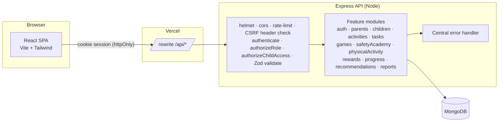
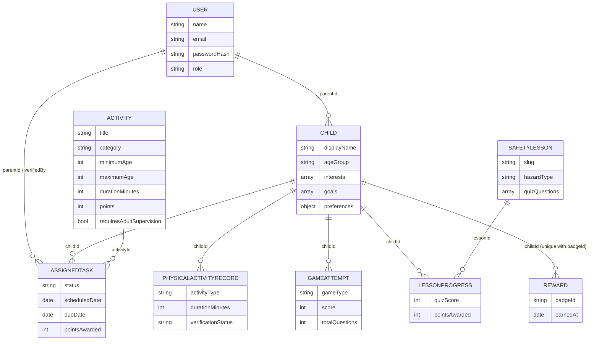

# GrowWise — Smart Parenting and Child Development Platform

A full-stack MERN web application that helps parents encourage healthy routines, movement, logical thinking, creativity, life skills and disaster preparedness in children — through assigned real-world missions, brain games and a safety academy, with gentle, transparent rewards and **no pressure toward more screen time**.

> College minor project. See [Limitations](#limitations-and-future-enhancements) for what is and is not included.

## Table of contents
1. [Problem statement](#problem-statement) · 2. [Objectives](#objectives) · 3. [Key features](#key-features) · 4. [Tech stack](#technology-stack) · 5. [Architecture](#architecture-overview) · 6. [Folder structure](#folder-structure) · 7. [Data model](#database-models) · 8. [API](#api-endpoints) · 9. [Setup](#setup-from-a-clean-checkout) · 10. [Env vars](#environment-variables) · 11. [Seeding](#seeding-the-database) · 12. [Testing](#testing) · 13. [Deployment](#deployment) · 14. [Design decisions for the viva](#important-modules-and-design-decisions-viva-guide) · 15. [Limitations](#limitations-and-future-enhancements)

## Problem statement
Families want children to move more, think creatively, learn practical skills and know what to do in an emergency, while reducing recreational screen time. Good activity ideas are scattered, hard to keep consistent and hard to track. Parents need one place to choose age-appropriate activities, assign them, verify completion and see progress, in a way children actually enjoy.

## Objectives
- Provide a parent workflow: child profiles → assign activities → verify → progress and reports.
- Provide a simple, playful, age-appropriate child experience without child accounts or personal data.
- Reward effort and participation transparently, with rewards calculated only on the server.
- Teach safety skills (earthquake, flood, fire, lightning, heat, contacts, kit, family plan) as clearly-labelled educational exercises.
- Be secure by design: server-side authorization, ownership checks, validation, minimal data.

## Key features
| Area | What it does |
|---|---|
| Parent area | Dashboard (real data), children management, tasks (assign / edit / cancel / review), progress & weekly report, settings |
| Child mode | Locked to one child; missions, level path, badges, brain games, safety lessons, movement logging. Leaving requires the parent password |
| Activity library | 68 seeded activities in 7 categories, ages 3–17, search + category/age/duration filters + pagination |
| Task workflow | `assigned → submitted → approved / needs-revision`, plus `cancelled`; atomic, duplicate-proof approval |
| Rewards | Points (from the activity record), levels (50 points each), 12 badges, no leaderboards, no streak resets |
| Brain games | Memory Match, Number & Pattern Quiz, Riddle Challenge — hints, explanations, replay; scores computed on the server |
| Safety Academy | 8 lessons with objectives, steps, parent-supervised practice, printable checklist, quiz (60 % pass), sources |
| Movement tracking | Manual only; *child-reported* vs *parent-reported* clearly separated; never described as medical data |
| Recommendations | Rule-based engine (age, time, materials, supervision, interests, repetition, weekly balance) with a reason for each suggestion; works without any AI key |
| Progress | Day/week/month, category minutes, 8-week trend, game and lesson stats, honest empty states (Recharts) |

**Points:** base by category — physical 10, brain games 10, creativity 10, family 10, life skills 15, outdoor 15, disaster preparedness 15 — plus 5 for "challenging" activities (a few set to 20). They live on each `Activity` record, so they are configurable.

## Technology stack
- **Frontend:** React 18, Vite 5, JavaScript/JSX, Tailwind CSS 3, React Router 6, Axios, Recharts, Lucide React, React Hook Form, react-hot-toast
- **Backend:** Node.js 22, Express 4, Mongoose 8 (MongoDB), Zod validation, bcryptjs, jsonwebtoken (httpOnly cookie), helmet, cors, express-rate-limit, cookie-parser, morgan, dotenv
- **Tests:** `node:test` (backend, real HTTP against a real database), Vitest + Testing Library (frontend)
- **Deploy:** Vercel (frontend) + any Node host (Render/Railway/Fly) + MongoDB Atlas

## Architecture overview


**Request flow for a protected child-data route:** `authenticate` (cookie → user + mode) → `validate` (Zod) → `authorizeRole` → `authorizeChildAccess` (child belongs to this parent; child-mode sessions only their own child) → controller → service → Mongoose.

### Sessions and child mode
Children do not have accounts. A logged-in parent presses **Open child mode**; the API issues a second kind of session token (role `child`, locked to one `childId`, 12 h). That token can submit tasks, play games, log movement and read its own data, but **cannot** verify tasks, edit profiles, list other children or touch account settings — enforced on the server. **Exit** requires the parent's password.

## Folder structure
```
growwise/
├─ client/                       React app
│  └─ src/
│     ├─ components/ {layout,navigation,cards,forms,charts,modals,feedback,ui}
│     ├─ pages/ {public,parent,child,activities,games,safety,progress,settings}
│     ├─ services/               one Axios client + one file per API area
│     ├─ context/                AuthContext, ChildrenContext
│     ├─ hooks/ utils/ test/
├─ server/
│  ├─ src/
│  │  ├─ config/ (env.js, db.js)
│  │  ├─ middleware/ (authenticate, authorizeRole, authorizeChildAccess, validateRequest, csrf, errorHandler)
│  │  ├─ modules/<feature>/      model · validation · service · controller · routes
│  │  └─ utils/  app.js  server.js
│  ├─ scripts/ (seed.js, seedData/)
│  └─ tests/
├─ docs/ (TESTING_CHECKLIST.md, DEMO_CHECKLIST.md, api-requests.http)
└─ e2e/                          optional browser smoke test (see e2e/README.md)
```

## Database models

Notes: `User.passwordHash` is `select:false` and stripped from JSON. `Reward (childId, badgeId)` and `LessonProgress (childId, lessonId)` have **unique indexes**, so a badge or a lesson award can only happen once. Points are *derived* (sum of approved task awards + lesson awards) and never stored as a counter. Deleting a child or account cascades to all its records.

## API endpoints
Envelope: `{ "success": true, "data": …, "meta": { page, limit, total, pages } }` or `{ "success": false, "error": { "message", "details": [{field, message}] } }`. Authentication is by the httpOnly cookie `gw_token`. Every **state-changing** request must send `X-Requested-With: XMLHttpRequest` (the web app does this automatically). Sample requests: [`docs/api-requests.http`](docs/api-requests.http).

| Method & path | Who | Purpose |
|---|---|---|
| POST `/api/auth/register` · `/login` · `/logout` · GET `/me` | public / any | Account + session. Role is never accepted from the client |
| POST `/api/auth/exit-child-mode` | child session | Returns to parent mode with the parent password |
| GET/PATCH/DELETE `/api/parents/me` · POST `/me/password` | parent/admin | Profile, preferences, password change, account deletion |
| POST/GET `/api/children` · GET/PATCH/DELETE `/api/children/:id` | parent (GET :id also its own child) | Child profiles (GET :id includes dashboard summary) |
| POST `/api/children/:id/session` | parent | Start child mode |
| GET `/api/children/:id/tasks` · `/physical-activity` · `/games/progress` · `/progress?range=day\|week\|month` · `/recommendations?minutes=&limit=` · `/badges` | parent or that child | Child data (ownership checked) |
| GET `/api/children/:id/reports/weekly` | parent | Weekly report |
| GET `/api/activities` (`q, category, age, difficulty, minDuration, maxDuration, indoor, page, limit`) · GET `:id` | any logged in | Library |
| POST/PATCH `/api/activities` | **admin only** | Content management (no UI; use the API) |
| POST `/api/tasks` · GET `/api/tasks` · PATCH `:id` | parent (GET also child, own tasks) | Assign, list, edit/cancel pending |
| POST `/api/tasks/:id/submit` | parent or child | Submit for verification |
| POST `/api/tasks/:id/verify` | **parent only** | `{decision:"approve"\|"reject", parentNote}` |
| POST `/api/physical-activity` · POST `:id/verify` · DELETE `:id` | create: parent/child · verify/delete: parent | Manual movement log |
| GET `/api/games` · GET `/api/games/:type/questions` · POST `/api/games/:type/attempts` | parent/child | Types: `memory-match`, `pattern-quiz`, `riddle-challenge` |
| GET `/api/safety-lessons` · GET `:id` · POST `:id/complete` | parent/child | Lessons and server-scored quizzes |
| GET `/api/health` | public | Liveness |

Status codes: 400 bad request, 401 not logged in, 403 role/origin not allowed, 404 not found *(also used for other parents' children)*, 409 conflict (duplicate, already verified), 422 validation, 429 rate limited.

## Setup from a clean checkout
**Prerequisites:** Node.js 20+ (tested on 22), npm, and MongoDB (local `mongod` or a free MongoDB Atlas cluster).

```bash
git clone <your-repo-url> growwise && cd growwise
npm run install:all                      # installs server/ and client/

# 1. Configure the server
cp server/.env.example server/.env       # then edit it (see below); generate JWT_SECRET:
node -e "console.log(require('crypto').randomBytes(48).toString('hex'))"

# 2. Seed content + fictional demo accounts
npm run seed                             # add:  -- --reset --demo   for a clean DB with demo history

# 3. Run (two terminals)
npm run dev:server                       # http://localhost:5000  (health: /api/health)
npm run dev:client                       # http://localhost:5173
```
Open http://localhost:5173. The Vite dev server proxies `/api` to the API, so cookies stay same-site and no CORS tweaking is needed.

**Create a development account:** use *Register* in the UI, or log in with the seeded fictional accounts printed by the seed script (`demo.parent@growwise.test`, `demo.admin@growwise.test`; password = `SEED_DEMO_PASSWORD`, or a random one printed once). These are development-only fictional accounts.

**Make an administrator** (needed only for `POST/PATCH /api/activities`): register normally, then in `mongosh`: `db.users.updateOne({email:"you@example.com"},{$set:{role:"admin"}})`. Admin accounts have no child features.

## Environment variables
`server/.env` (see `server/.env.example`):
| Variable | Meaning |
|---|---|
| `MONGODB_URI` | e.g. `mongodb://127.0.0.1:27017/growwise` or your Atlas URI (**required**) |
| `JWT_SECRET` | ≥ 32 random characters (**required**; the server refuses to start otherwise) |
| `JWT_EXPIRES_IN` | parent session length, default `7d` |
| `PORT` | default `5000` |
| `CLIENT_ORIGIN` | the exact origin of the frontend, e.g. `http://localhost:5173` or `https://growwise.vercel.app` (CORS + CSRF origin check) |
| `NODE_ENV` | `production` makes cookies `Secure` |
| `COOKIE_CROSS_SITE` | `true` only if the frontend calls the API host directly on a different site (uses `SameSite=None; Secure`) |
| `SEED_DEMO_PASSWORD` | optional password for the fictional demo accounts |

`client/.env` (optional): `VITE_API_BASE_URL` — leave empty in dev; no secrets belong in frontend variables.

## Seeding the database
`npm run seed` is idempotent (upserts by activity title / lesson slug). Flags: `--reset` wipes every collection first (always refused when `NODE_ENV=production`), `--demo` adds demo history (tasks, movement, game rounds, a lesson) for the fictional child "Mia". It loads **68 activities** (10 each for physical, brain games, creativity, life skills, outdoor, disaster preparedness; 8 family) across ages 3–17, and **8 safety lessons**.

## Testing
```bash
npm test                         # backend then frontend
npm --prefix server test         # 39 tests; needs MongoDB. Uses database "growwise_test" (dropped!) 
npm --prefix client test         # 27 tests (Vitest, jsdom)
npm run lint                     # ESLint (client) + syntax check (server)
```
Set `MONGODB_URI_TEST` to point the backend tests elsewhere. Backend tests cover: registration/login, password rules, role escalation, CSRF layer, parent authorization, child ownership, child-mode restrictions, activity filtering, assignment rules, the full submit → approve flow, forged points, **six concurrent approvals awarding points once**, reject/resubmit, games scoring, movement tracking, safety completion, badge idempotence, progress numbers, weekly report privacy, and the recommendation engine's constraints. Frontend tests cover forms and validation, route guards, dialogs, game logic and a regression test for the loading boundary.

A manual checklist is in [`docs/TESTING_CHECKLIST.md`](docs/TESTING_CHECKLIST.md); an optional automated browser run is in [`e2e/`](e2e/README.md).

## Deployment
**Database:** create a MongoDB Atlas cluster, a database user, and allow your API host's IP; copy the connection string into `MONGODB_URI`.

**Backend (Render / Railway / Fly.io):** root directory `server`, build `npm install`, start `npm start`. Set `NODE_ENV=production`, `MONGODB_URI`, `JWT_SECRET`, and `CLIENT_ORIGIN=https://<your-vercel-domain>`. Seed the production database once with `npm run seed -- --force-prod` (the script refuses to run in production without that flag, and `--reset` is always refused in production). Skip `--demo` in production.

**Frontend (Vercel):** root directory `client`, framework Vite. Edit `client/vercel.json` and replace `YOUR-API-HOST.example.com` with your API host. The rewrite proxies `/api` through the Vercel domain, so the cookie is first-party (`SameSite=Lax`) and no cross-site cookie settings are needed. (Alternative: set `VITE_API_BASE_URL` to the API URL and `COOKIE_CROSS_SITE=true`.) `CLIENT_ORIGIN` **must** equal the Vercel domain because the API checks the `Origin` header.

Nothing in this repository has been deployed by the author of this README; the steps above are untested instructions.

## Important modules and design decisions (viva guide)
- **`middleware/authenticate.js`** — verifies the JWT cookie, loads the user from the database (role comes from the database), and distinguishes `parent`/`admin` from `child` sessions.
- **`middleware/authorizeChildAccess.js`** — the parent–child ownership gate used by every child-scoped route; returns 404 for someone else's child so IDs cannot be probed.
- **`middleware/csrf.js`** — Origin check + required custom header (browsers cannot add it cross-site without a CORS preflight, which our CORS policy refuses).
- **`middleware/validateRequest.js`** — Zod schemas per route; `.strict()` bodies reject unexpected fields such as `role`, `pointsAwarded`, `status`, `parentId`.
- **`modules/tasks/tasks.service.js`** — `verifyTask` uses one atomic `findOneAndUpdate({status:'submitted'} → approved)`, so only one request can win; points are read from the `Activity` document, never from the request.
- **`modules/rewards/rewards.service.js`** — points are derived from immutable records; badges are rule functions (`badges.js`) stored through a unique index, so they are idempotent.
- **`modules/games`** — question banks live on the server; the client sends chosen answers and the server computes the score (a client-sent `score` is rejected). Answers/explanations are sent with the questions to allow instant feedback — acceptable because games award no points.
- **`modules/recommendations/recommendation.engine.js`** — pure function: hard filters (age, time, outdoor space, supervision, materials, published) run **before** scoring; an optional `rerank` hook can only reorder already-eligible items, so a future AI layer cannot bypass safety rules.
- **`modules/progress`** — aggregates in JavaScript from plain queries (no `$lookup`/`$facet`), keeping the queries simple and portable.
- **Frontend `AsyncBoundary` + `useAsync`** — consistent loading / error / empty states; stale data stays visible while reloading.

## Limitations and future enhancements
Honest list of what this version does **not** do or has not verified:
- **Verification environment:** automated checks were run against **FerretDB (MongoDB-compatible, SQLite)**, not a real `mongod` or Atlas, because no MongoDB server was available in the build environment. Queries deliberately avoid `$text`, `$lookup`, `$facet` and transactions, but run the test suite against real MongoDB before relying on it.
- **Not deployed:** no Vercel/Atlas/hosting deployment was performed.
- **Reminders** are preferences shown in the app; there is no email/push delivery.
- **No password reset or email verification**; no multi-factor authentication.
- **Sessions are stateless JWT cookies:** logout clears the cookie but a copied token stays valid until expiry. Rate limiting is in-memory (per server instance).
- **No admin UI** for activities/lessons (admin API only).
- **Safety content is draft educational content** written from public guidance (sources listed per lesson); it is **not certified** by an emergency authority. Review against your local authority (e.g. NDMA India, local fire service) before real use. Emergency numbers shown are for India and should be verified.
- **Dependencies:** `npm audit` reports a moderate advisory in `react-router` v6 (fix requires the breaking v7 upgrade) and development-tooling advisories (Vite/esbuild dev server, Tailwind's `braces`); they were not force-upgraded. The server has no production-dependency advisories at the time of writing.
- **Browser coverage:** UI checks were run in headless Chromium only (desktop 1280, tablet 768, phone 375 widths). Safari/Firefox, real touch devices and screen readers were not tested. Web fonts could not load in the offline build environment, so visuals were checked with fallback fonts.
- **Future ideas:** email/push reminders, password reset, admin content editor, expert-reviewed and localised safety content (e.g. Hindi), optional AI-assisted recommendations behind the existing `rerank` hook, family challenges, data export.
